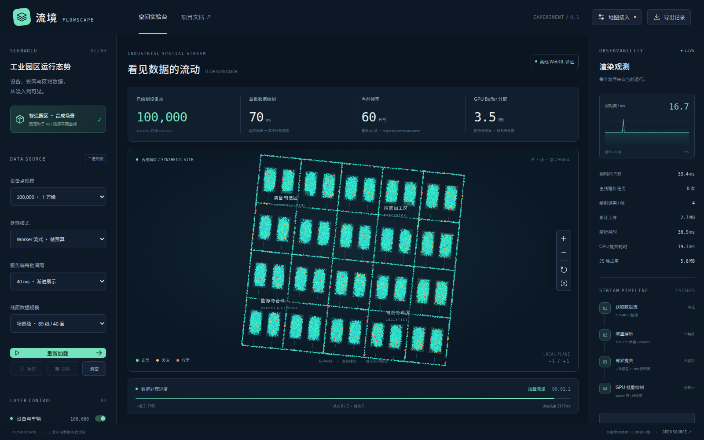

# 流境 FlowScape · Baidu-JSAPI

基于百度地图 JSAPI WebGLLayer，探索工业场景下海量点、线、面数据的流式加载、异步处理与高性能渲染。

> 工程验证版：已有可运行的独立 WebGL Demo、流式处理链路、四种对照模式与自动验证。真实百度地图 WebGLLayer 接入仍待开发者认证、项目 AK 与赛题扩展合同；当前离线结果不能作为百度图层验收。

## 赛题与目标

本项目面向「AI+ 工业软件赛道」百度地图赛题：**基于百度地图 JSAPI 的海量空间数据流式高性能渲染技术**。

核心目标是让空间数据「边下载、边处理、边显示」，在后台持续处理海量数据时，仍能流畅缩放、平移和旋转地图。

Demo 采用**工业园区设备与管网运行监控**：设备和车辆用点表示，管网和运输路径用线表示，园区及能源分区用面表示。数据由固定种子生成，明确标为合成数据，坐标是局部平面坐标。



## 已实现的核心链路

实现与验收状态见 [路线图](docs/roadmap.md)，原始测量与局限见 [性能报告](docs/performance-report.md)。

已完成 **120 次正式对照**。在独立 NVIDIA A40 WebGL 下，最大混合档位为 **200 万点 + 20 万线 + 10 万面，共 300 万顶点**，四模式各重复 5 次，流式模式加载及全量稳态 rAF 帧间隔 P95 约 16.7–16.8 ms。主线程分块已是强基线，Worker 与软预算没有稳定的额外收益，详见原始数据与报告。rAF 不是显示器实际呈现或 GPU 执行时间。

- **真正的增量链路**：Node HTTP 分帧输出 → Fetch Stream → Worker 惰性解析 → Transferable → 两批额度控制 → GPU 增量上传。
- **GPU 数据组织**：交错 Float32 顶点、固定容量 Buffer 页、`bufferSubData`、按几何类型批量绘制，清空时释放图层资源。
- **三类几何规模**：点参数上限 200 万、线参数上限 20 万、面参数上限 10 万；参数上限与实测能力分别报告。
- **运行控制**：暂停、继续、取消、重载、图层开关、缩放、平移和旋转；模拟设备状态每秒更新最多 512 个已加载点。
- **四种对照**：全量下载解析、主线程分块、Worker 无预算、Worker 帧预算，保持相同数据和绘制内核。
- **真实观测**：首次绘制调用、流读取结束、帧时间、长任务、队列峰值、上传字节、图层 Buffer 分配与可用时的 JS 堆数据。

3 ms 提交预算是批次之间检查的软预算，不能抢占一次 GPU 调用。CPU/GPU 使用率当前不可采集时明确为不可用，首次绘制调用时间也不等同显示器呈现时间。

百度地图公开资料和赛题任务书的接口核验见 [调研记录](docs/research/webgllayer.md)。项目不会把内部类、其他地图接口或独立 Canvas 冒充赛题 WebGLLayer。

## 评分对应

| 评审维度 | 权重 | 计划交付的证据 |
| --- | --- | --- |
| WebGL 高性能渲染能力 | 40% | 点、线、面渲染；Buffer 与 Draw Call 数据；相同数据下的对照测试 |
| 流式数据处理能力 | 25% | 首批结果早于全部下载完成；分阶段时间线；吞吐与队列记录 |
| 实时交互与系统性能 | 20% | 持续加载时缩放、平移、旋转的 FPS、帧时间与长任务记录 |
| 工业场景应用与工程实现 | 15% | 工业园区 Demo、运行说明、技术文档、测试报告 |

## 项目文档

- [赛题要求与验收映射](docs/requirements.md)
- [五幕故事线](docs/story.md)
- [开发路线图](docs/roadmap.md)
- [性能测试计划](docs/performance.md)
- [运行与复现指南](docs/guide.md)
- [性能与验证报告](docs/performance-report.md)
- [架构与模块合同](docs/design.md)
- [贡献指南](CONTRIBUTING.md)

## 快速开始

需要 Node.js **22.18 或更高版本**、支持 WebGL / Fetch Stream / Web Worker 的现代浏览器。

```bash
git clone https://github.com/yanchaomei/Baidu-JSAPI.git
cd Baidu-JSAPI
npm ci
npm run dev
```

打开终端显示的本地地址，点击「开始流式加载」。离线验证不需要 AK。线面规模可切换为「海量混合」。

生产方式：

```bash
npm run build
npm start
```

默认地址为 `http://127.0.0.1:4173`。生产包需要 Node 数据服务，不能仅将 `dist/` 当作完整静态应用部署。

自动验证：

```bash
npm test
npx playwright install chromium
npm run test:browser
npm run benchmark
```

先启动应用，再运行浏览器检查与基准。浏览器脚本默认使用软件 SwiftShader；通过 `GPU_BACKEND=hardware` 和 `CHROMIUM_EXECUTABLE` 可以复现硬件 Vulkan 路径，必须核验实际 renderer。软件与 NVIDIA A40 的功能验收均已完成；真实百度图层与主办方设备另行验收。

## 开源范围

本仓库自有代码采用 [MIT License](LICENSE)。自托管的 Noto Sans SC 界面字形子集采用 [SIL Open Font License](public/fonts/OFL.txt)，并保留 [来源与校验值](public/fonts/provenance.json)。百度地图 JSAPI、底图、第三方依赖及外部数据遵循各自的使用条款与许可证。

发布示例配置时仅使用占位值。百度地图浏览器端 AK 按官方应用配置要求设置来源限制，不在仓库中保存真实凭据。
